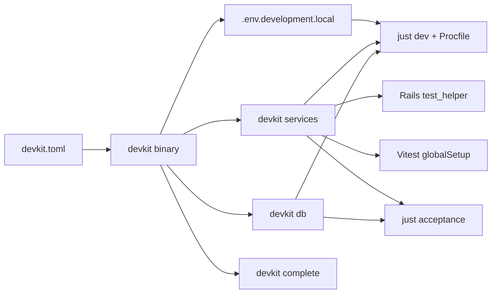
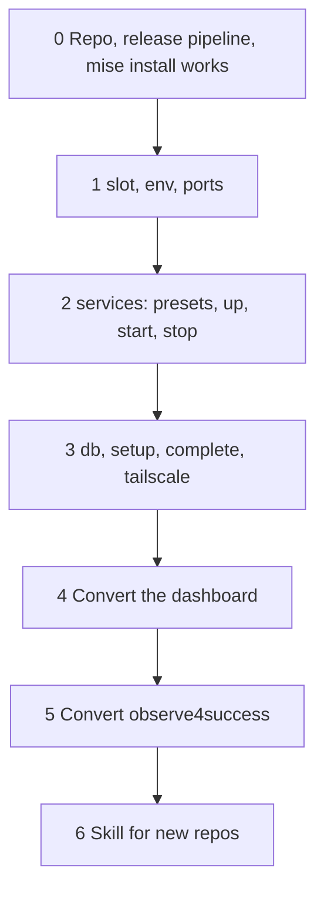

# devkit: shared local services, port slots, and databases for worktrees

Date: 2026-10-13
Status: phases 0 to 3 built, tested, and released as v0.1.0 on 2026-10-13 (public repo `gstark/devkit`; CI and Release green; `mise install` of the asset proven on macOS). Phase 4 (dashboard) done on 2026-10-13 on the dashboard branch `devkit`, UNCOMMITTED there; v0.1.2 is what it pins. Phase 6 (skill) done on 2026-10-13: `~/.agents/skills/devkit/SKILL.md` points at `doc/adopting.md`. Phase 5 (observe4success) not started. See "Implementation notes" at the end for where the build differs from the design below.
Repository: `gstark/devkit` (this repo)
First consumers: `dds/dashboard/app`, then `o4s/observe4success`

## Why

Two repositories carry hand-copied bash for the same four jobs:

| Job | dashboard | observe4success |
|---|---|---|
| Pick a port slot per worktree, write `.env.development.local` | `scripts/dev/worktree` (312 lines) | `script/dev/worktree` (405 lines) |
| Start local servers (RustFS, LiveKit, Gotenberg) | `scripts/dev/lib/*.sh`, `test/support/*_test_server.rb`, `spa/test-support/*/server.ts` | `e2e/compose.yml` (Docker, acceptance only) |
| Clone a pristine Postgres database per worktree | `scripts/dev/worktree` | `script/dev/worktree` |
| Tear a worktree down | `scripts/dev/worktree --complete` | `script/dev/worktree --complete` (newer: locks, `kill_tree`) |

The two worktree scripts share eight helper functions by name and differ in 389 lines. The dashboard repeats its service supervision three times (bash, Ruby, TypeScript). Every new project of this shape would be a fourth copy.

## Decisions

- One Go binary, `devkit`, released on GitHub and pinned per repo with the mise `github:` backend, the same way `rustfs` is pinned today.
- One manifest per repo, `devkit.toml` at the repo root.
- The repo lives at `gstark/devkit`.
- The dashboard converts first. observe4success converts second.
- DB-per-worktree is in scope.

## What devkit owns and what stays in each repo



devkit owns:

- Port slots and the env file keys for them.
- Service processes: start, readiness, detach, stop, stale cleanup.
- Built-in presets for RustFS and LiveKit.
- Pristine database build (through a repo hook), per-worktree clone, drop.
- Storage directory snapshot and clone next to the database.
- Worktree completion: stop this checkout's servers, remove Tailscale handlers, drop the database, clear env keys.
- Tailscale publish and unpublish for a named port.
- Cross-worktree locks.

Each repo keeps:

- The Procfile and the process runner (foreman or overmind).
- Vite proxy rules, `config/storage.yml`, `Secrets`, `database.yml`. They read the exported env as they do now.
- The seed that builds the pristine database.
- The justfile. Recipes become one-line `devkit` calls.
- Test adapters of about ten lines each (see below).

## The manifest

`devkit.toml` for the dashboard. Values in braces are templates devkit fills in.

```toml
[project]
name = "dds_dashboard"            # database prefix, lock names, pid dir
env_file = ".env.development.local"
state_dir = "tmp/devkit"          # pid files, rendered configs, logs

# Named ports with no service behind them. The app's own processes use them.
[ports.spa]
default = 3000
env = "DDS_SPA_PORT"

[ports.rails]
default = 3001
env = "DDS_RAILS_PORT"
extra_env = { RAILS_DEV_ORIGIN = "http://localhost:{port}" }

[services.s3]
preset = "rustfs"
default_port = 9000
skip_if_set = "AWS_ENDPOINT_URL_S3"   # another S3 is configured: do not start
data_dir = "storage/rustfs"           # dev profile; test and acceptance use a temp dir
bucket = "dds-dev"
extra_env = { DASHBOARD_STORAGE_BUCKET_NAME = "{bucket}" }

[services.s3.profiles.acceptance]
bucket = "dds-acceptance"

[services.s3.profiles.test]
bucket = "dds-test"
buckets = ["dds-test", "dds-test-mbs-import"]

[services.livekit]
preset = "livekit"
default_port = 7880                   # signalling; media on +1 TCP and +2 UDP
skip_if_set = "LIVEKIT_URL"
webhook_url = "http://localhost:{ports.rails}/api/v1/video_calls/webhooks"
extra_env = { LIVEKIT_CLIENT_URL = "{origin.spa}" }

[services.livekit.profiles.test]
webhook_url = ""
loopback_only = true
extra_env = { LIVEKIT_CLIENT_URL = "" }   # empty string unsets the key

[database]
env = "DDS_DEV_DATABASE"
pristine = "dds_dashboard_worktree_pristine"
worktree = "dds_dashboard_wt_{slug}"
build = "scripts/dev/seed-dev-db"      # runs with {database.env} set to the pristine name
migrate = "bundle exec rails db:migrate"
storage_dir = "storage"
pristine_storage = "{xdg_data}/dds-dashboard/worktree-pristine/storage"

[setup]
install = ["bundle install --quiet", "cd spa && pnpm install --frozen-lockfile"]
copy_env_keys = ["DDS_DEV_TAILSCALE"]   # from the main checkout when this worktree has none

[tailscale]
flag = "DDS_DEV_TAILSCALE"
publish = "spa"
origin_env = "DDS_SPA_ORIGIN"

[complete]
pid_files = ["tmp/pids/server.pid", "tmp/pids/acceptance-rails.pid"]
process_patterns = ["puma", "rails server", "foreman", "vp dev", "vite", "openapi:watch", "good_job"]
```

A generic service, with no preset, declares everything. Gotenberg for observe4success:

```toml
[services.gotenberg]
default_port = 3005
ports = { tcp = 1 }
command = ["docker", "run", "--rm", "--network", "host", "o4s-e2e-gotenberg:7.10.2",
           "gotenberg", "--api-port={port}", "--chromium-restart-after=1"]
ready_url = "http://127.0.0.1:{port}/health"
install_hint = "docker compose -f e2e/compose.yml build gotenberg"
extra_env = { GOTENBERG_BASE_URL = "http://127.0.0.1:{port}" }
```

Template variables: `{port}`, `{port+1}`, `{ports.<name>}`, `{origin.<name>}` (the Tailscale URL when published, else `http://localhost:<port>`), `{bucket}`, `{slug}`, `{data_dir}`, `{xdg_data}`, `{root}`.

### Presets

A preset is a service definition compiled into the binary. The manifest overrides any field.

`rustfs`:

- command `rustfs server --address 127.0.0.1:{port} {data_dir}`
- env for the process: `RUSTFS_ACCESS_KEY`, `RUSTFS_SECRET_KEY` with fixed dev values
- ready URL `http://127.0.0.1:{port}/health/ready`
- after ready: create each bucket, set the CORS rule that allows browser GET, PUT, POST, HEAD with `ETag` exposed
- exports `AWS_ENDPOINT_URL_S3`, `AWS_ACCESS_KEY_ID`, `AWS_SECRET_ACCESS_KEY`, `AWS_ACTIVE_STORAGE_REGION`, and unsets `AWS_SESSION_TOKEN`
- install hint: `mise install`

`livekit`:

- renders `livekit.yaml` into the state dir with `port`, `rtc.tcp_port`, `rtc.udp_port`, `use_external_ip: false`, one API key, the webhook block when `webhook_url` is set, and the loopback-only ICE settings when `loopback_only` is true
- command `livekit-server --config {config}`
- ready URL `http://127.0.0.1:{port}/`
- exports `LIVEKIT_URL`, `LIVEKIT_API_KEY`, `LIVEKIT_API_SECRET`, `LIVEKIT_WEBHOOK_URL`
- install hint: `brew install livekit` on macOS, `mise install` on Linux

Both presets use one fixed credential pair across dev, test, and acceptance. Today the dashboard uses different pairs in bash and in the test supervisors for no reason.

## Commands

### Slot and ports

| Command | Effect |
|---|---|
| `devkit slot` | Print this checkout's slot. Main checkout is 0. |
| `devkit slot claim` | In a linked worktree: find the first free slot and write the ports to the env file. A slot is free when no sibling worktree's env file holds it and no process listens on its ports. Idempotent. |
| `devkit slot release` | Remove the slot and port keys from the env file. |
| `devkit env [--profile P] [--format sh\|json]` | Print every env key devkit would export for this checkout: ports, service settings, database. `just dev` evals the `sh` form. |

Every port is `default + slot * 10`. Slot 1 gives SPA 3010, Rails 3011, LiveKit 7890, RustFS 9010. The dashboard already follows this rule.

### Services

| Command | Effect |
|---|---|
| `devkit services up [--profile P]` | Start every enabled service in the foreground and wait. One line in the Procfile. A service whose `skip_if_set` key is set, or whose binary is missing, prints why and does not start. `up` stays alive either way, because foreman stops every process when one exits. |
| `devkit services start [--profile P] [--ephemeral] --json` | Start the services detached and print JSON: `env`, `pid_file`, and per-service `port`, `pid`, `log`. With `--ephemeral`: random free ports and temporary data directories, removed on stop. Test runs use this. |
| `devkit services stop [PID_FILE]` | Stop the servers in the pid file: TERM, wait two seconds, KILL. LiveKit drains rooms on TERM for minutes, so the wait is short. |
| `devkit services stop --stale` | Stop servers from pid files whose starting process is gone. The acceptance script runs this first. |
| `devkit services doctor` | Check each binary is on PATH at the pinned version and print the install hint for each missing one. |

Profiles: `dev` (default), `test`, `acceptance`. A profile overrides fields per service.

### Database

| Command | Effect |
|---|---|
| `devkit db pristine [--yes]` | Drop and rebuild the pristine database by running the `build` hook, then snapshot `storage_dir` into `pristine_storage`. Prompts unless `--yes`. Holds the shared lock. |
| `devkit db clone [--reset]` | Create this worktree's database from the pristine one with `template ... strategy file_copy`, then clone the pristine storage into `storage_dir` (`cp -c` on macOS, `cp --reflink=auto` on Linux). Keeps an existing database unless `--reset`. Builds the pristine database when it is missing. Runs the `migrate` hook. |
| `devkit db drop` | Drop this worktree's database with `force`. Never drops any other name. |

The database name uses `{slug}`: the worktree directory name, lower case, non-alphanumerics to `_`, cut to 40 characters.

### Worktree lifecycle

| Command | Effect |
|---|---|
| `devkit setup [--reset]` | Refuse in the main checkout. Take the worktree lock. Run `install`. Copy the env file or the listed keys from the main checkout. `db clone`. `slot claim`. Print the summary. This is `just worktree`. |
| `devkit complete` | Stop every server whose working directory is inside this checkout and whose command matches `process_patterns` or whose pid is in `pid_files`. Remove the Tailscale handlers for this slot's ports. `db drop`. `slot release`. This is `just worktree-complete`. |
| `devkit tailscale publish PORT_NAME` | Publish `127.0.0.1:<port>` at `https://<MagicDNS>:<port>` and print the URL. |
| `devkit tailscale off PORT_NAME` | Remove the handlers that proxy to that port. |

Locks: a shared lock in the common git dir guards pristine builds and slot claims. A per-worktree lock in the worktree's git dir serializes two `setup` runs in one worktree. T3 Code starts the setup command twice at once, which is why observe4success added these.

## Test adapters

Rails, before `config/environment` loads:

```ruby
# test/support/devkit.rb
require "json"
services = JSON.parse(`devkit services start --profile test --ephemeral --json`)
ENV.update(services.fetch("env"))
owner = Process.pid
at_exit { system("devkit", "services", "stop", services.fetch("pid_file")) if Process.pid == owner }
```

The servers are not children of the test process, so the debug gem's `at_exit` wait on children no longer matters. Parallel workers fork after the env is set and share the servers, as today.

Vitest global setup:

```ts
// spa/test-support/devkit.ts
import { execFileSync } from 'node:child_process';
export async function setup(project) {
  const services = JSON.parse(execFileSync('devkit', ['services', 'start', '--profile', 'test', '--ephemeral', '--json'], { encoding: 'utf8' }));
  Object.assign(process.env, services.env);
  project.provide('livekitUrl', services.env.LIVEKIT_URL);
  project.provide('s3Endpoint', services.env.AWS_ENDPOINT_URL_S3);
  return () => execFileSync('devkit', ['services', 'stop', services.pid_file]);
}
```

The browser-side commands (`spa/test-support/livekit/commands.ts`, `s3/commands.ts`) and the test participant helper stay. They are test logic, not supervision.

## Distribution

- GoReleaser builds `darwin/arm64`, `linux/amd64`, `linux/arm64` on tag and publishes a GitHub release.
- Each repo pins it in `mise.toml`: `"github:gstark/devkit" = "0.1.0"`.
- CI runs `jdx/mise-action`, which installs devkit, rustfs, and livekit-server at the pinned versions. The two `scripts/ci/install-*` scripts in the dashboard go away.
- `livekit-server` has no macOS GitHub release. The preset accepts the Homebrew binary. `devkit services doctor` says which to install.

## Phases



### Phase 0: skeleton

- `go mod init github.com/gstark/devkit`, cobra for commands, `BurntSushi/toml`, `shirou/gopsutil` for process working directories.
- GoReleaser config, tag `v0.0.1`, prove `mise install` places it on PATH in a scratch repo.
- Tests must run with `go test ./...`. Unit tests for the manifest parser, template expansion, slot math, env file read and write.

### Phase 1: slot, env, ports

- Env file read, write, remove, with the same line format as today so existing files keep working.
- `slot`, `slot claim`, `slot release`, `env`.
- Integration test: two fake worktrees claim slots 1 and 2.

### Phase 2: services

- Process supervisor: spawn detached with a log file, poll the ready URL, pid file with the starting pid and cwd, stop, stale sweep.
- Free-port search for N TCP ports followed by M UDP ports, random base between 20000 and 59000, 50 tries.
- `rustfs` and `livekit` presets, bucket and CORS setup with the AWS SDK for Go.
- Profiles and `--ephemeral`.
- `up` with the idle-when-disabled behavior.
- Integration tests run against real `rustfs` and `livekit-server` binaries. CI installs them with mise.

### Phase 3: database and lifecycle

- `db pristine`, `db clone`, `db drop` through `psql`, with the `with (force)` drop and the open-session count message.
- Storage snapshot and clone.
- `setup` and `complete` with both locks.
- Process stop by working directory. gopsutil gives `Cwd()` on macOS and Linux.
- Tailscale publish and off, parsing `tailscale serve status --json`.

### Phase 4: convert the dashboard

1. Add `devkit.toml` and the mise pin.
2. `just dev`: `eval "$(devkit env --format sh)"` replaces the port, RustFS, LiveKit, and Tailscale blocks in `scripts/dev/dev`. Procfile gets `services: devkit services up` in place of the `s3` and `livekit` lines.
3. `just worktree`, `worktree-pristine`, `worktree-complete`: one `devkit` call each. Delete `scripts/dev/worktree`.
4. `just acceptance`: `devkit services stop --stale`, then `devkit services start --profile acceptance --json`, in place of the hand-rolled leftover sweep and server starts. Rails and Vite starts stay in the script.
5. Tests: `test/support/devkit.rb` replaces `test_server_process.rb`, `rustfs_test_server.rb`, and the start calls in `livekit_test_server.rb`. Keep `RustfsTestServer.client` and the LiveKit constants as thin readers of `ENV`.
6. Vitest: `spa/test-support/devkit.ts` replaces `serverProcess.ts` and the two `server.ts` files.
7. Delete `scripts/dev/lib/rustfs.sh`, `scripts/dev/lib/livekit.sh`, `scripts/dev/rustfs`, `scripts/dev/livekit`, `scripts/ci/install-*`. CI uses `jdx/mise-action`.
8. Update `doc/development-setup.md`.
9. Check: `just dev` in main and in a worktree, `just worktree` end to end, `just worktree-complete`, Rails suite, Vitest services project, `just acceptance --yes`, CI green.

### Phase 5: convert observe4success

1. Add `mise.toml` (none today) with devkit, rustfs, and the Ruby and Node pins. Add `devkit.toml` with `ports.rails`, `services.s3`, `services.gotenberg`, the Beach County build hook, and `copy_env_file = true`.
2. `just dev`: `eval "$(devkit env --format sh)"` and `services: devkit services up` in `script/dev/Procfile.dev`. S3 becomes available in dev, not only in acceptance.
3. `just worktree*`: one `devkit` call each. Delete `script/dev/worktree`.
4. `just acceptance --pdf`: `devkit services start --profile acceptance` replaces `docker compose up`. RustFS runs native. Gotenberg stays in Docker as a generic service.
5. RSpec: a `spec/support/devkit.rb` adapter when a spec needs S3.
6. Check: same list as the dashboard, plus the PDF snapshot specs.

### Phase 6: skill

- `~/.agents/skills/devkit/SKILL.md`: when to use devkit, the manifest shape, the three integration points (Procfile, test adapter, justfile), and the conversion checklist above.

## Risks and open items

- **Two package managers for one tool.** LiveKit comes from Homebrew on macOS and mise on Linux. `doctor` must report both paths clearly.
- **RustFS has no Intel macOS build.** Same as today.
- **Docker services.** Gotenberg through `docker run` has no pid devkit can TERM directly. The supervisor must stop it through `docker stop` by a container name it sets. Add `container_name` to the generic service fields.
- **Process stop by cwd.** gopsutil's `Cwd()` on macOS needs the same user. Dev servers always are.
- **Overmind versus foreman.** observe4success uses overmind, which has a socket and `overmind quit`. `complete` tries `overmind quit` when `.overmind.sock` exists, then falls back to process stop.
- **Scope held back on purpose.** devkit does not replace foreman or overmind, does not run the app's own servers, and does not own the seed. If a later project wants a Procfile runner with readiness probes, `process-compose` is the candidate, not devkit.

## Implementation notes (2026-10-13)

What the built tool does differently from the design above. The design text
above is left as written; this section wins where they disagree.

- **`--owner PID` on `services start`.** The pid file records the process the
  servers belong to. It defaults to devkit's parent, which is right for Ruby
  backticks and Node `execFileSync`. A shell script must pass `--owner $$`,
  because `$(devkit ...)` runs devkit in a subshell that exits at once and
  `--stale` would otherwise treat the servers as orphaned.
- **`DEVKIT_ENABLED_SERVICES`.** `devkit env` exports the list of enabled
  services. A later `devkit services up` under that env trusts the list instead
  of `skip_if_set`, because the env devkit exported (`AWS_ENDPOINT_URL_S3`,
  `LIVEKIT_URL`) would otherwise make every service look externally configured.
- **`DEVKIT_SLOT`, `DEVKIT_PROFILE`, `DEVKIT_PID_FILE`** are exported too.
  `slot claim` writes `DEVKIT_SLOT` and the named ports to the env file. A
  worktree with a port on a slot boundary but no `DEVKIT_SLOT` still resolves
  (the dashboard's existing env files work unchanged).
- **Profiles apply the slot too.** `[profiles.acceptance] ports = { spa = 4710 }`
  gives slot 1 port 4720, so two worktrees can run acceptance at once. A
  service's acceptance port comes from
  `[services.s3.profiles.acceptance] default_port = 4715`; without it the
  service keeps its dev port, which collides with a running `just dev`.
- **JSON output keys.** `env`, `unset`, `ports`, `services`, `slot`, `profile`,
  and `devkit_pid_file` (lower case). Consumers must apply `unset` as well as
  `env`; the test profile clears `LIVEKIT_CLIENT_URL` and `LIVEKIT_WEBHOOK_URL`
  that way.
- **Preset exports are generic.** `rustfs` exports `AWS_ENDPOINT_URL_S3`,
  `AWS_ACCESS_KEY_ID`, `AWS_SECRET_ACCESS_KEY`, `AWS_REGION`, and unsets
  `AWS_SESSION_TOKEN`. The dashboard adds `AWS_ACTIVE_STORAGE_REGION` and
  `DASHBOARD_STORAGE_BUCKET_NAME` through `extra_env`.
- **LiveKit binds every interface in dev** and loopback only when
  `loopback_only = true` (the test profile). The design had `bind_addresses`
  on always, which would have cut tailnet devices off from media.
- **Alive checks ignore zombies.** `kill(pid, 0)` succeeds on a zombie, so a
  child that died but was not reaped looked alive forever. Found by the
  lifecycle test, which stops a stray process it started itself.
- **Pid files live in `tmp/devkit/<profile>-<owner pid>.pids.json`** so two
  concurrent test runs in one checkout do not clash. Logs sit next to them.
- **`services doctor`** exists as designed. It checks presence, not version.
- **Docker services** stop through `docker stop <container_name>`; the
  manifest field is `container_name`.

Verified by hand on 2026-10-13 against a scratch repository with real
`rustfs` and `livekit-server`: `env`, ephemeral `start`/`stop` with bucket and
CORS creation, foreground `up` under SIGTERM, `--stale`, `setup` from a fresh
worktree (pristine build, template clone, storage clone, slot 1), idempotent
re-run, and `complete` stopping devkit services, stray processes, and the
database. `go test ./...` covers the same with Postgres and the binaries
present; the gated tests skip without them. `goreleaser release --snapshot`
builds all four targets. Not yet done: pushing to `gstark/devkit`, tagging
`v0.1.0`, and proving `mise install` of the released asset.

## Phase 4 results (2026-10-13)

Dashboard branch `devkit`, 33 files changed, +274/-1344, four new files
(`devkit.toml`, `test/support/devkit_services.rb`, `spa/test-support/devkit.ts`,
`scripts/ci/install-dev-services`), twelve deleted (the worktree script, the
three bash libs, the two Procfile wrappers, the two CI installers, the Ruby
supervisor, the two Vitest server setups and their process helper).

Verified: full Rails suite (8375 runs, 0 failures), SPA services project (21
tests), `just acceptance --yes e2e/video-calls/room.spec.ts` with real rooms,
`devkit db pristine --yes` through the seed hook with its own RustFS, `devkit
setup` + `devkit complete` in a scratch worktree (slot 4, 130 accounts in the
clone), a live `just dev` with the `services` Procfile line, and
`just stop-servers` finding the devkit services.

Found along the way:

- The rustfs preset's `AWS_REGION` export changed `Secrets[:aws_region]`;
  the dashboard manifest unsets it (`AWS_REGION = ""`).
- Three video-calls tests hardcoded the old `test_api_key`; they now use
  `LivekitTestServer::API_KEY`.
- `devkit setup` had to claim the slot before the database clone, because the
  dashboard's build hook starts RustFS on the slot's port (v0.1.2).
- `--reuse` and `--only` on `services start` exist for `just seed-dev-db`,
  which borrows a running `just dev` RustFS or starts one for the load (v0.1.1).
- Acceptance uses `--ephemeral` for its S3 and LiveKit, so only the SPA and
  Rails ports are fixed (4710/4711 plus the slot); the fixed 4712-4715 ports
  are gone.
- 22 stale `dds_dashboard_wt_t3code_*` databases from old worktrees sit on
  the dev Postgres; `devkit complete` would have dropped them. Not touched.
